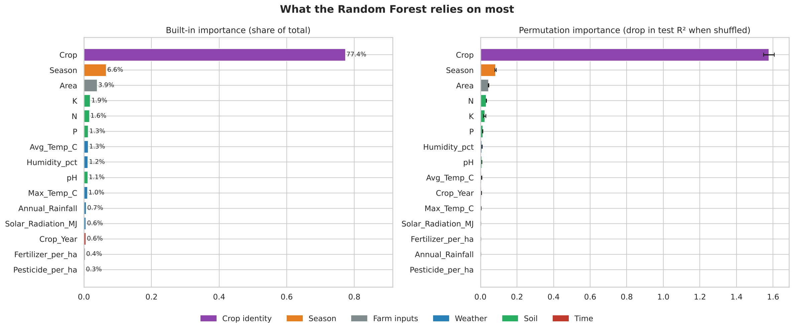
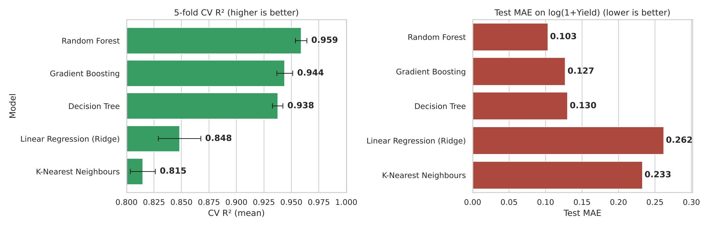

# 🌾 AI-Based Crop Yield Prediction System

Predict the yield (per hectare) and total production of **55 crops across 30 Indian states**, using a Random Forest
trained on **19,689 real crop records**, **soil nutrients (N, P, K, pH)** and **24 years of weather data**.

**▶ Try it online (no install):** *link added once the website is deployed*



## Features

* **Real data only**: government crop statistics, state soil profiles and ERA5 weather from the Open-Meteo API
* **5 machine-learning models compared** in the same scikit-learn pipeline: Random Forest wins (test R² 0.973)
* **Explainable**: feature-importance charts and a study of what each data source adds
* **Prediction with an 80% confidence range**, compared with the real historical yield for that crop and state
* **Web app** with four tabs: Predict · Model comparison · Feature importance · Data & method
  (online version built with Streamlit; local version built with Gradio, both using the same model code)
* **Full analysis notebook** with exploratory charts, tuning, error by crop and a future-years test

## Run it on your computer

You only need **[Python 3.12 or newer](https://www.python.org/downloads/)** (on Windows, tick *"Add python.exe to PATH"* while installing).

1. Download this project: green **Code** button → **Download ZIP**, then unzip it
   (or `git clone https://github.com/namishmittal21-dotcom/crop-yield-prediction.git`).
2. Start the app:
   * **Windows:** double-click **`run_app.bat`**
   * **macOS / Linux:** open a terminal in the folder and run `./run_app.sh`
3. The app opens in your browser at http://127.0.0.1:7860.

The first run creates a private Python environment in a `.venv` folder (so it never clashes with other Python projects),
installs the tested package versions and trains the model. This takes a few minutes; later runs start in seconds.

To explore the analysis, use **`open_notebook.bat`** (Windows) or **`./open_notebook.sh`** (macOS/Linux).

> Windows may show *"Windows protected your PC"* or *"The publisher could not be verified"* because the launcher isn't code-signed.
> Click **More info → Run anyway** / **Run**. The launcher only sets up Python packages and starts the app (you can open it in Notepad to check).

<details>
<summary>Manual setup (any OS)</summary>

```bash
python -m venv .venv
# Windows: .venv\Scripts\activate     macOS/Linux: source .venv/bin/activate
pip install -r requirements.txt          # app only
pip install -r requirements-notebook.txt # app + notebook
python app.py                            # local app (Gradio)
streamlit run streamlit_app.py           # same app as the website (Streamlit)
```
</details>

## Data sources

| Data | What it adds | Source |
|---|---|---|
| Crop yield records (19,689 rows, 1997–2020) | Crop, season, state, year, area, production, rainfall, fertilizer, pesticide, **yield** | *Crop Yield in Indian States*, Kaggle (akshatgupta7); Mendeley Data DOI 10.17632/ncw2vbcgnk.2 |
| Soil profile per state | Nitrogen, phosphorus, potassium, pH | State soil table from *Crop Yield Data with Soil and Weather*, Kaggle (anshumish) |
| Weather per state per year | Average and max temperature, humidity, solar radiation | [Open-Meteo Historical Weather API](https://open-meteo.com/en/docs/historical-weather-api) (ERA5 reanalysis); points in `data/weather_points.csv` |

## Results

Target: log(1 + yield). 80/20 train/test split and 5-fold cross-validation.

| Rank | Model | CV R² | Test R² | Test MAE (log) |
|---|---|---|---|---|
| 1 | **Random Forest** | 0.959 | 0.973 | 0.103 |
| 2 | Gradient Boosting | 0.944 | 0.963 | 0.127 |
| 3 | Decision Tree | 0.938 | 0.950 | 0.130 |
| 4 | Linear Regression (Ridge) | 0.848 | 0.854 | 0.262 |
| 5 | K-Nearest Neighbours | 0.815 | 0.840 | 0.233 |

Predicting unseen years (train 1997–2016, test 2017–2020): **R² = 0.951**.

<details>
<summary>What each data source adds (Random Forest, CV R²)</summary>

| Feature set | CV R² |
|---|---|
| Crop + season + farm inputs only | 0.9248 |
| + State name | 0.9583 |
| + Soil (N, P, K, pH) | 0.9615 |
| + Weather | 0.9482 |
| + Soil + Weather  (final model) | 0.9589 |
| + Soil + Weather + State name | 0.9593 |
</details>

**Most important inputs (Random Forest):**

| Feature | Share of importance |
|---|---|
| Crop | 77.4% |
| Season | 6.6% |
| Area | 3.9% |
| K | 1.9% |
| N | 1.6% |
| P | 1.3% |
| Avg_Temp_C | 1.3% |
| Humidity_pct | 1.2% |



## Project structure

```
streamlit_app.py           Web app hosted online (Streamlit Community Cloud)
app.py                     Local web app (Gradio), opened by run_app.bat / run_app.sh
crop_model.py              Shared model code: loads data, trains or loads the model, predicts with a range
Crops_Prediction.ipynb     Full analysis: data, EDA, 5-model comparison, tuning, feature importance
data/                      Crop records, soil table, weather table and weather coordinates
outputs/                   Result tables and charts
run_app.bat / run_app.sh   One-click setup and launch
open_notebook.bat / .sh    One-click notebook
requirements*.txt          Tested package versions
.streamlit/config.toml     Website theme
```

## Limitations

State-level averages rather than farm measurements; soil is one value per state; weather is taken at one point per state;
fertilizer and pesticide in the source data are national yearly averages; predictions after 2020 extrapolate past trends.
Estimates are for learning and comparison, not agronomic advice.

## License

Code: MIT (see `LICENSE`). Datasets remain under the terms of their original sources.
